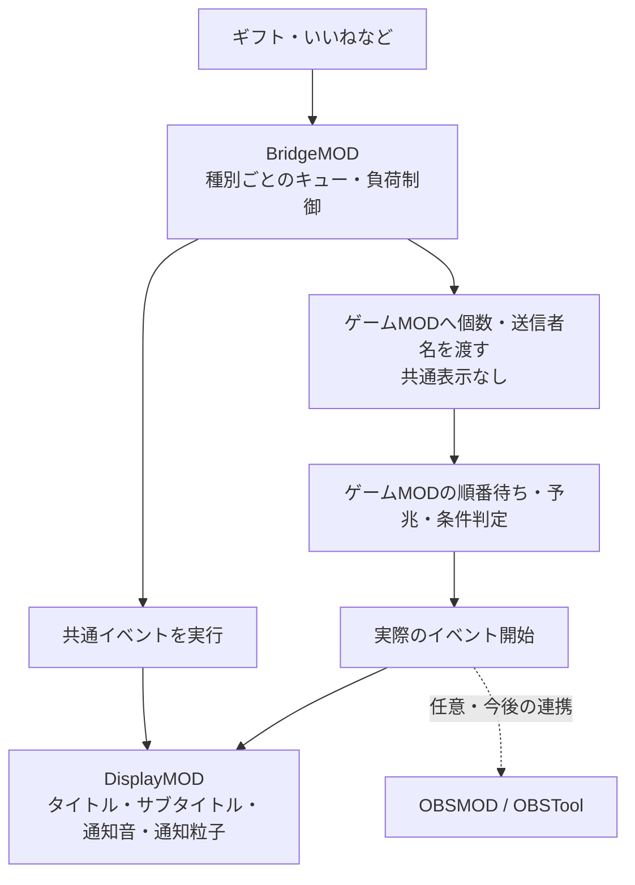

# DisplayMOD：共通表示を独立MODへ分離

対象：Minecraft Java 1.20.1 / Forge 47 / Java 17。開発版の仕様。アプリ更新・公開リリースは保留。

## 役割と表示タイミング



- **BridgeMOD**：イベント受付、ギフト／いいね／その他のキュー、負荷制御、コマンド・Mob召喚・物理演出、Mobへの名前付与、固定環境を担当。共通表示はAPIへの依頼だけにする。
- **DisplayMOD**：単独の`displaymod-1.0.0.jar`。タイトル等の共通通知を描画する。BridgeMOD・ゲームMOD・OBSMODへの依存はない。
- **ゲームMOD**：ゲームの進行・順番待ちを管理し、実際の開始時にDisplayMODを直接呼ぶ。受付時には表示を出さない。
- 流星群の軌跡や爆発など、イベント本体の効果・音・粒子はBridgeMODに残す。ルーレット独自の回転表示やアプリの読み上げは今回の共通タイトル分離とは別。
- OBS連携は未実装。ゲーム本体がOBSMODを必須にしない方針は維持する。

## そうてんもんさんの3つの確認事項

| 確認 | 実装 |
|---|---|
| 他MODから直接呼べるか | 可能。下記の公開APIはBridgeMOD不要 |
| BridgeMOD側で共通表示あり／なしを選べるか | 可能。コマンドの表示担当とHTTPの`announce`で制御 |
| 表示MODがなくてもゲームを続けられるか | 可能。任意連携用ヘルパーは未導入・API不一致・表示例外を`false`として返す |

## Java API v1

公開クラス：`jp.douma.displaymod.api.DisplayApi`

```java
public static boolean show(Object serverObject, Map<String, ?> payload)
```

`serverObject`には実行中の`MinecraftServer`を渡す。`Object`と`Map`のシグネチャを使用し、難読化されたMinecraftの型名やDisplayMODの独自型に任意連携側が依存しない構成にしている。サーバースレッド以外からの呼び出しはサーバーへ実行を委譲する。

| payloadの項目 | 型 | 省略時・制限 |
|---|---|---|
| `title` | String | 必須。表示時60文字まで |
| `subtitle` | String | `{ListenerName}`。表示時120文字まで |
| `listenerName` | String | `viewer`。60文字まで |
| `count` | Number（整数） | 1。1～100000 |
| `sound` | String | `minecraft:entity.experience_orb.pickup`。空文字で通知音なし |
| `particle` | String | `minecraft:happy_villager`。空文字で通知粒子なし |

タイトル・サブタイトルの`{ListenerName}`と`{Count}`を置換する。名前の中に同じ文字列が含まれても再展開しない。文字列をMinecraftコマンドとして実行しない。通知粒子は追加パラメータ不要の粒子に対応し、未知のIDや不正なIDはその装飾だけ省略する。

戻り値`true`は表示要求の受付、`false`はスキップ。プレイヤー不在でも受付は成功するため、「実際に見えた」という確認ではない。**戻り値によってゲームイベントの成否を変えないこと。**

## 任意依存のままゲームMODから呼ぶ

`examples/display-integration/OptionalDisplay.java`をゲームMODへコピーし、packageをそのゲーム独自の名前に変更する。同名クラスが複数MODに入らないようにする。このヘルパーはBridgeMODもDisplayMODもビルド時・実行時の必須依存にしない。

```java
// 受付時ではなく、ゲーム側のキューから取り出して実際に開始する場所に置く。
startActualGameEvent(event);
OptionalDisplay.show(server, Map.of(
    "title", "ゲームイベント開始！",
    "subtitle", "{ListenerName}さん ×{Count}",
    "listenerName", event.listenerName(),
    "count", event.count(),
    "sound", "minecraft:entity.experience_orb.pickup",
    "particle", "minecraft:happy_villager"
));
// 表示がfalseでも、既に開始したゲームイベントはそのまま続行する。
```

`startActualGameEvent`と`event`は呼び出し位置を示す例であり、UmetateMODやRunMODの実APIではない。各ゲームMODに合わせて実装する。

DisplayMODを必須とする環境では公開APIを直接importしてもよいが、今回の運用では上記の任意連携ヘルパーを使用する。`mods.toml`にDisplayMODを`mandatory=true`で登録しない。

## BridgeMODの共通表示スイッチ

既存のHTTP `POST /bridge/event`の`announce`を利用する。

```json
{"type":"gift","key":"zombie","count":3,"listenerName":"赤堀堂馬","announce":true}
```

| コマンドtxtの指定 | `announce:true` | `announce:false` |
|---|---|---|
| 未指定、または`# DISPLAY_OWNER: bridge` | 最初の成功した実行時に1回依頼 | 表示しない |
| `# DISPLAY_OWNER: game` | BridgeMODは表示しない。ゲーム側が実開始時に呼ぶ | 同左 |
| `# DISPLAY_OWNER: none` | BridgeMODは表示しない | 表示しない |

`announce:true`であっても`game`を上書きしない。待機イベントの受付時に誤って表示することを防ぐ。BridgeMOD内部のキューで待っている間も表示しない。tickをまたいで分割実行しても共通表示は重複しない。保護エリアでスキップしたイベント、見つからないコマンド、全コマンドが失敗したイベントも表示しない。

ゲームパックの`game.json`では、各コマンドに`"commonDisplay": true`を付けるとBridgeMODの共通表示を有効にする。省略または`false`はゲーム側担当。既存のゲームパックは既定の「共通表示なし」を維持する。

```json
{"key":"instant","title":"即時イベント","command":"実際のゲームMODのコマンド","commonDisplay":true}
```

## 配置と単独確認

- アプリの通常配布・ゲーム切替はBridgeMOD＋DisplayMOD＋選択ゲームMODを配置する。DisplayMODは独立jarなので取り外して運用できる。
- DisplayMODはサーバー側で標準Minecraftの表示パケットを送るため、クライアント側にDisplayMODがなくても表示できる。アプリは保存先管理を揃えるため両側へ配置する。
- DisplayMODだけを入れたサーバーでも以下のコマンドで試せる。権限レベル2以上が必要。

```text
/displayevent {"title":"表示テスト","subtitle":"{ListenerName}さん ×{Count}","listenerName":"テスター","count":3}
```

表示は接続中の全プレイヤーへ同じ内容を送る。タイトルは黄色・太字、サブタイトルは緑、10tickで表示・70tick保持・10tickで消える。現時点では表示MOD自身に待機キューや重複除去はなく、次のタイトルが来ると置き換わる。ゲーム側は実開始時に1回だけ呼ぶ。ゲームキューを表示側へ移さない。

先に合意しておきたい点は、この「全員へ表示」「タイトルの上書き」「送信者名・個数をゲームキュー内で保持する」の3点。後から対象プレイヤーや表示レイアウトを拡張する場合はAPIの互換性を保って追加する。

## 開発・検証

```text
cd BridgeMod
gradlew build
cd ../DisplayMod
../BridgeMod/gradlew build
cd ..
node scripts/test-display-contract.cjs
```

Windowsでは`gradlew.bat`を使う。テスト用の偽API・テストコードは製品jarに同梱しない。アプリのバージョン・公開リリース・利用中のサーバーへの反映は別操作。

参考：[ForgeのMOD依存関係](https://docs.minecraftforge.net/en/1.20.x/gettingstarted/modfiles/)、[Forgeのサイドと任意クライアント](https://docs.minecraftforge.net/en/1.20.x/concepts/sides/)。
