# 10月3日からの変更で、そうてんもんさんのゲームMODは何をすればよいか

2026年10月13日

> 想定読者は、StackingGame-EventsとOBSMODを作っているそうてんもんさんです。前回の報告（10月3日）を読んでいる前提で書きました。
>
> 前回説明した連携API（requestId・gameSessionId・count・OptionalDisplay）と、アプリの内部の作りは省きました。
>
> 読むのにかかる時間は約15分です。版とAPIはgitとソースから取り出し、本文と照合しました。StackingGame-EventsとOBSMODの本体との組み合わせは、今回も試していません。

この報告は、10月3日から13日までの変更のうち、そうてんもんさんのゲームMODに関係するものと、お願いしたいことを伝えます。

| 節 | この節で伝えること | 見せるもの |
|---|---|---|
| 0 | 変更ごとの影響とお願いの対応 | 一覧表 |
| 1 | どの版で何が変わったか。まだ配布していないこと | 図1 |
| 2〜5 | ゲームMODに関係する4つの変更 | 図2〜4、コード |
| 6 | 知っておいてほしい変更と制限 | 本文 |
| 7 | 遊び方の変更 | 一覧表 |
| 8〜9 | お願いのまとめと、理解度チェック | チェックリスト |

## 0. 一枚で

まず、ゲームMODがブロックを書き換えるかを確かめてください。Javaでブロックを置き換える（`setBlock`）処理や、`fill`・`setblock`・`clone`を実行する処理があれば、2節と4節が関係します。プレイヤーに効果を付ける処理や、モブやTNTを出すだけの処理なら、2節と4節は関係ありません。

| 変更（版） | ゲームMODへの影響 | お願い |
|---|---|---|
| 保護ブロックAPI（BridgeMOD 1.6.0） | ブロックを書き換える処理が、配信ワールド（MAP）の進行用のコマンドブロックを壊すことがある | 書き換えの前に`canModifyBlock`を呼び、コマンドは`runProtected`で包む |
| 強さの上限をやめた（BridgeMOD 1.7.0、saikutuMOD 1.1.0） | BridgeMODはcountを減らさない。ゲームMODには送られた数のまま届く | 上限を掛けるかを、ゲームMODごとに決める |
| 壊せないブロックを残す（BridgeMOD 1.7.1、saikutuMOD 1.1.1） | 岩盤・バリア・エンドポータルの枠は、地形の効果で書き換えない | ゲームMODでも同じ扱いにする（任意） |
| ゲームMODの自動入れ替え（次の配布のアプリ） | アプリを更新すると、アプリが置くMODのjarが両側で新しい版になる。手で登録したゲームパックは登録した版のまま | 版を上げてもMOD IDを変えない |
| HTTPのトークン認証（BridgeMOD 1.5.0） | JavaのAPIを使うゲームMODには影響しない | HTTPで試すツールには`X-Bridge-Token`を付ける |
| 送信者名の整え方（BridgeMOD 1.5.0） | ゲームMODに届く送信者名も、整えたあとの名前になる | 名前を比べる処理があれば確認する |
| 暴風雨と天気の一時変更（既知の制限） | 暴風雨が終わると、ほかのMODの天気の一時変更も消える | `holdWeather`を使うなら、この動きを前提にする |

## 1. 版の変化

**ここに書いた変更は、どれもまだ配布していません。**
最後の配布は10月3日のアプリ1.0.46で、BridgeMOD 1.4.0が入っています。次のアプリの配布で、下の版がまとめて届きます。配布の時期はまだ決まっていません。



| MOD | 前回の報告 | 今 |
|---|---|---|
| BridgeMOD | 1.4.0 | 1.7.4 |
| DisplayMOD | 1.1.0 | 1.1.0（変更なし） |
| saikutuMOD | 1.0.1 | 1.1.4 |

DisplayMODは変えていません。前回説明した連携API（要求番号、ゲーム番号、count、表示API）の形も同じです。送信者名の整え方だけが変わりました（6節）。

## 2. 保護ブロックAPI

**ゲームMODが地形を書き換えるなら、保護ブロックAPIを使ってください。**
配信で使うワールド（MAP）の進行に使うコマンドブロック3種（`command_block`・`chain_command_block`・`repeating_command_block`）を、妨害の自動処理から守るAPIです。BridgeMOD 1.6.0で足しました。

BridgeMODとsaikutuMODは、すでにこのAPIを使っています。ゲームMODがJavaでブロックを書き換えるときや、`fill`・`setblock`を実行するときは、次のように呼んでください。

<!-- output: api-example -->
```java
import jp.douma.bridgemod.api.BlockProtection;

// Java でブロックを書き換える前に呼ぶ。保護ブロックなら飛ばす（処理全体は止めない）。
if (BlockProtection.canModifyBlock(level, pos)) level.setBlock(pos, state, 3);

// fill・setblock などのコマンドを実行するときは包む。実行のあとで、変わった保護ブロックを中身ごと戻す。
BlockProtection.runProtected(server, "mygame", () -> {
    server.getCommands().performPrefixedCommand(source, "fill ~-3 ~-1 ~-3 ~3 ~-1 ~3 minecraft:air");
});
```

`runProtected`は、処理の前に近くのコマンドブロックを控え、処理のあとで変わったものを中身ごと戻します。戻し方は、ワールドを読み込むときと同じ方法です。そのため、インパルス型のコマンドブロックが置き直しで再実行されることはありません。



使うときは、`mods.toml`でbridgemodの`versionRange`を`[1.6.0,)`以上にしてください。古いBridgeMODと組み合わせると、起動時に`NoClassDefFoundError`で止まります。

守れる範囲には限りがあります。控えるのは、プレイヤーの描画距離・強制読み込み・スポーンチャンクの周り2チャンクまでの、読み込み済みのチャンクだけです。`/data`で中身だけを書き換えた場合は戻しません。詳しくは`docs/ゲームMOD連携API_v1.4.md`の「保護ブロックAPI」の節にあります。

## 3. 強さの上限をやめた

**BridgeMODはcountを減らしません。ゲームMODには、送られた数のまま届きます。**
これは配信者の方針です。視聴者はギフトを100個送ったら100回分の妨害を期待するので、送られた数どおりに起こします。サーバーが重くなって落ちるのも妨害のうちで、落ちたら配信者が「ちょっと待ってね」と言って立て直す、という考えです。



10月9日に一度、BridgeMODの標準の効果に上限（鶏の雨は3倍までなど）を入れました。10月11日に、この上限をやめています。ゲームMODへの要求のcountは、どちらの時期も減らしていません。前回の報告どおり、整数1〜100,000を1要求で渡します。

アプリの運用センターにある「個別最大コマンド数」は、BridgeMOD経由で送る要求には掛けなくなりました。ゲームMOD向けの要求には、もともと掛けていません。RCONやTelnetで送る場合だけ、今までどおり掛けます。saikutuMODも上限を掛けません。たとえばTNT大爆発は、N個で半径がN倍の衝撃波を1回起こします。

そうてんもんさんのゲームMODで上限を掛けるかは、ゲームMODごとに決めてください。配信者の方針に合わせるなら、掛けない形になります。掛けない場合、大きなcountでサーバーが重くなったり落ちたりすることがありますが、配信者はそれを受け入れています。

## 4. 壊せないブロックを残す

**BridgeMODとsaikutuMODは、地形の効果で壊せないブロックを書き換えません。**
対象は、硬さが負のブロック（岩盤・バリア・エンドポータルの枠など）です。Javaで地形を書き換える効果（衝撃波、天変地異の穴、流星群、火山など）すべてに効きます。BridgeMOD 1.7.1とsaikutuMOD 1.1.1で入れました。

txtの`fill`・`setblock`と、TNT大爆発の頭上のTNTは、この判定を通りません。コマンドの実行に判定を挟むと処理が重くなるため、配信者の判断で今のままにしています。

ゲームMODでも同じ扱いにすると、MAPの仕掛けに使うバリアなどが残ります。必須ではありません。

## 5. ゲームMODの自動入れ替え

**アプリを更新すると、アプリが置くMODのjarが、サーバーとMinecraftの両方で自動で新しい版になります。**
これまでは、アプリを更新しても、採掘MOD（アプリに同梱のゲームMOD）はホームで「保存」を押し直すまで古いままでした。10月13日に、BridgeMODと同じく自動で入れ替わるようにしました。次の配布のアプリから動きます。



入れ替えるのは、アプリが置くMOD（BridgeMOD・DisplayMOD・ゲームMOD）のjarだけです。サーバーとMinecraftの両方で入れ替えます。どれがアプリのMODかは、jarの中の`mods.toml`のmodIdで見分けます。ほかのMODやファイルには触りません。

そのため、ゲームMODの版を上げても、MOD IDは変えないでください。変えると、新しい版を登録したあと「保存」より先にアプリを更新したときなどに、古いjarを見分けられず、両方がmodsに残ることがあります。

手で登録したゲームパックのjarは、アプリを更新しても変わらず、登録した版のままです。そうてんもんさんのゲームパックの新しい版は、これまでどおり「ゲームパックを登録」してから「保存」を押すと置かれます。BridgeMODとDisplayMODは、どのゲームでも自動で新しい版になります。

## 6. そのほかの変更と制限

### HTTPのトークン認証（BridgeMOD 1.5.0）

BridgeMODのHTTPとWebSocketは、サーバーを起動するたびに作る乱数のトークンで要求を確かめるようになりました。トークンは`<サーバーフォルダー>/config/bridgemod-token.txt`に書かれます。HTTPでは`X-Bridge-Token`ヘッダー、WebSocketでは`?token=`に付けてください。ブラウザーからの要求（`Origin`ヘッダー付き）は受け付けません。

JavaのAPI（GameEventsなど）を使うゲームMODには影響しません。HTTPでBridgeMODを試すツールを使っている場合だけ、トークンが必要です。あわせて、`/bridge`コマンドはOP（権限2）だけが使えるようにしました。

### 送信者名の整え方（BridgeMOD 1.5.0）

視聴者名をコマンドに埋め込んでも壊れないよう、名前を整えるようにしました。`"` `'` `\`は全角の`” ’ ＼`に置き換え、`§`の書式コードや制御文字を除き、40文字までにします。

BridgeMODは、届いた名前をこの形に一度だけ整え、表示・txt・ゲームMODで同じものを使います。

<!-- output: listener-name -->
```
            // HTTP・/bridge・/bridge/exec のどこから来た名前も、ここで一度だけ安全な形にする（表示・txt・ゲームMODで共通）。
            this.listenerName = ListenerNames.display(listenerName);
```

ゲームMODで送信者名を比べたり保存したりしている場合は、整えたあとの名前が届く前提で確認してください。

### 暴風雨と天気の一時変更（既知の制限）

`EnvironmentOverrides.holdWeather`は、ゲームMODがしばらく天気を変えたままにしたいときに使うAPIです。使わない場合、BridgeMODは天気を晴れに戻す作りです。BridgeMODの暴風雨は、雨が時間どおりに終わるときに、そのワールドのこの一時変更をすべて消します。たとえばsaikutuMODの吹雪も、続いている途中で暴風雨の終わりと同時に止まる、という動きです。

配信者の判断で、この動きは直しません。暴風雨や氷河期を続けて使うことは、配信ではないためです。ゲームMODで`holdWeather`を使う場合は、この動きを前提にしてください。使っていなければ関係ありません。

## 7. 遊び方の変更

ゲームMODに直接は関係しない変更です。配信での見え方が変わるので、一覧で伝えます。

| 効果 | 変わったこと |
|---|---|
| TNT大爆発（採掘） | N個で横48×N・上下11×Nの楕円体を、衝撃波で1回えぐる。衝撃波は毎秒40ブロックで広がる |
| スーパージャンプ | 1個で32ブロック、重ねた分だけ高く上がる。高さの上限と低速落下をなくした（落下死することがある） |
| 暴風雨 | N個で雷20×N回・雨3分×N。雨が残っていれば足す。`/weather clear`のあとは今から数える |
| ルーレット | 送られた回数だけ続けて回す。別の人のルーレットとは、来た順にまとめて回す |
| ダイヤ装備・ネザライト装備 | 今の防具を持ち物へ移してから着せる。入らなければ足元に置く |
| 衝撃波・天変地異・氷河期（採掘） | 地形を書き換えている間に出たアイテム（支えを失った花・たいまつ・作物など）を出さない |
| 標準コマンド | 地形を壊す14個に「地形破壊系」の印を付けた。採掘速度上昇・低下は採掘パックへ移した |

## 8. お願いのまとめ

- [ ] ゲームMODで地形を書き換えるなら、`BlockProtection`を使い、`mods.toml`のbridgemodを`[1.6.0,)`以上にする
- [ ] ゲームMODでcountに上限を掛けるかを決める
- [ ] 壊せないブロックを書き換えないかを決める（任意）
- [ ] ゲームMODの版を上げても、MOD IDを変えない
- [ ] HTTPでBridgeMODを試すツールには、`X-Bridge-Token`を付ける
- [ ] `holdWeather`を使うなら、暴風雨の終わりで消えることを前提にする

StackingGame-EventsとOBSMODの本体との組み合わせは、こちらではまだ試せていません。つないで試した結果を教えていただけると助かります。

## 9. 理解度チェック

1. ゲームMODが`fill`で床を消します。MAPのコマンドブロックを守るには、何をすればよいですか。

<details><summary>答え</summary>

`fill`を`BlockProtection.runProtected`で包みます。`mods.toml`のbridgemodは`[1.6.0,)`以上が必要です。Javaで`setBlock`するなら、その前に`canModifyBlock`を呼びます（2節）。

</details>

2. 視聴者がギフトを500個送りました。ゲームMODに届くcountはいくつですか。

<details><summary>答え</summary>

500の1要求です。BridgeMODはcountを減らしません。上限を掛けるかは、ゲームMODが決めます（3節）。

</details>

3. ゲームMODの次の版でMOD IDを変えると、アプリを更新したときに何が起きますか。

<details><summary>答え</summary>

新しい版を登録したあと「保存」より先にアプリを更新すると、アプリは古いjarを自分のMODと見分けられません。そのため古いjarがmodsに残り、新しいjarと両方が並ぶことがあります（5節）。

</details>

4. 暴風雨のあとで、ゲームMODが`holdWeather`で保っていた天気が戻りました。これは不具合ですか。

<details><summary>答え</summary>

既知の制限です。暴風雨は時間どおりに終わるとき、天気の一時変更をすべて消します。配信者の判断で、直さないことにしました（6節）。

</details>
