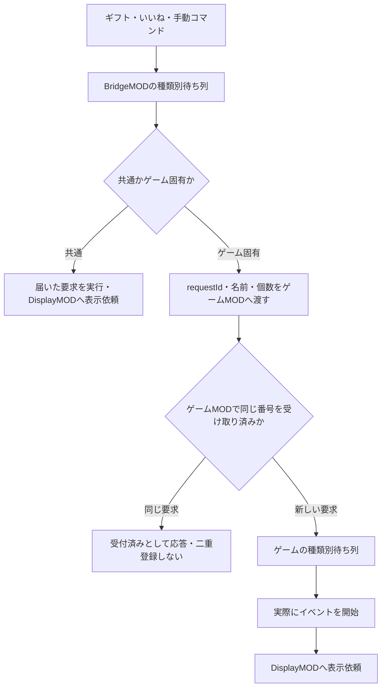

# ゲーム切替・saikutuMOD・要求番号の連携ガイド

2026-10-03。BridgeMOD 1.3.6 / saikutuMOD 1.0.0 / DisplayMOD 1.0.0。公開リリース・使用中アプリへの適用とは別の開発変更。

## 選択とコマンド

| アプリで選ぶ名前 | サーバー・Minecraftの両側へ配置 |
|---|---|
| サバイバル | BridgeMOD + DisplayMOD |
| 埋め立て | BridgeMOD + DisplayMOD + UmetateMOD |
| RUN | BridgeMOD + DisplayMOD + RunMOD |
| 採掘 | BridgeMOD + DisplayMOD + saikutuMOD |

BridgeMOD・DisplayMODは標準装備。ゲーム切替で他のMODは退避する。ワールドは変更しない。埋め立てとRUNの本体は未作成のため、選択肢に「未導入」と表示し、完成したパックを登録するまでは適用できない。

プレイヤーの入力は、どのゲームでも `/bridge コマンド名 回数`（OP＝権限2以上のプレイヤーだけ。中身は権限4で動くため）。採掘なら `/bridge otosiana 1` がsaikutuMODの落とし穴を実行する。`/saikutu otosiana 1` も開発・互換用に残す。

内部ファイルは `game_saikutu_otosiana.txt` などに分けるが、入力やコマンド一覧のコピーではこの接頭辞は不要。選択中のゲームの登録コマンドへ解決する。存在しないゲームのコマンドへは転送しない。共通コマンドと同じkeyを持つゲームパックは切替前に拒否する。

## 採掘へ移した16コマンド

最初の14件に、2026-10-12 に採掘速度上昇・低下の2件を足した（意味があるのがほぼ採掘だけなので。ユーザーの決定、saikutuMOD 1.1.2）。

| 表示名 | 共通入口 |
|---|---|
| ランダムテレポート（依頼時の「ランダムトラップ」） | /bridge randomtp 1 |
| 天空トラップ（依頼時の「天空テレポート」） | /bridge skytrap 1 |
| 天変地異 | /bridge cataclysm 1 |
| 氷河期 | /bridge iceage 1 |
| 洪水 | /bridge flood 1 |
| マグマ地獄 | /bridge maguma_jigoku 1 |
| 大地割れ | /bridge fissure 1 |
| 落とし穴 | /bridge otosiana 1 |
| TNT大爆発 | /bridge tntdaibakuhatu 1 |
| エンダーパール | /bridge get_ender_pearl 1 |
| 鉄ピッケル | /bridge get_iron_pickaxe 1 |
| 木材追加 | /bridge get_tree 1 |
| 水入りバケツ | /bridge get_water_backet 1 |
| ピッケル没収 | /bridge pikkerubossyuu 1 |
| 採掘速度上昇20秒 | /bridge give_haste 1 |
| 採掘速度低下10秒 | /bridge give_fatigue 1 |

強さの上限はない（saikutuMOD 1.1.0、2026-10-11 ユーザーの決定）。スクリプトは送られた回数だけくり返し、大技は count を倍率にする。サーバーが重くなる・落ちるのも妨害のうちで、上限・間引き・消去は入れない（地形を書き換えるときに落ちるアイテムを出さないのは、これとは別のユーザーの決定。下の TNT大爆発と、天変地異・氷河期を参照）。

TNT大爆発は、N 個で横 48×N・上下 11×N の楕円体を、1回の衝撃波でえぐる（saikutuMOD 1.1.0）。頭上の TNT は N に関係なく1回だけ降らせる。衝撃波は、発動から2秒後（足元の TNT が爆発するとき）に爆心から横へ毎秒40ブロックで広がる。横に調べるのは爆心からサーバーの描画距離（view-distance）＋2チャンクまで、上下は建築できる高さまでで、そこまでえぐり終えたら衝撃波は終わる。チャンクは読み込ませない：読み込まれていないチャンクのブロックを読むとサーバーがその場で読み込むので、えぐるのは周り1チャンクまで読み込み済みの列だけ（えぐったブロックの周りの溶岩・つる・柵・扉などの反応が先のブロックを読むため。バニラがブロックを動かすのと同じ条件）、爆発させるのは周り2チャンクまで読み込み済みの所だけにする（バニラで生き物が動くのと同じ条件）。保証もバニラと同じで、読み込まれた範囲の端をまたぐ長いトリップワイヤー・大きなネザーポータル・赤石の線や、端の近くで傷ついたエンダーマンは、バニラと同じくチャンクを読み込むことがある。えぐるのは他の地形の効果と同じ判定で、保護ブロック・BlockEntity・壊せないブロック（硬さが負：岩盤・バリア・エンドポータルの枠など。saikutuMOD 1.1.1 から）は残す。えぐったブロックはアイテムにしない。上に載っていた花やたいまつなど、えぐったことで支えを失って壊れたブロックもアイテムにしない（saikutuMOD 1.1.3、2026-10-12 ユーザーの決定。えぐっている最中に出たアイテムだけを消すので、そのあいだにプレイヤーが掘った分や、前から落ちていたアイテムは消さない。少しあと（次の tick 以降）に壊れるもの、つまりサボテン・サトウキビ・竹・落ちてきた砂や砂利・葉の自然消滅・流れ込んだ水や溶岩・額縁や絵、頭上の TNT の爆発で壊れたブロックは、普通にアイテムで落ちる）。1 tick に空気へ変えるのは、全部の衝撃波を合わせて50,000ブロックまで（残りは次の tick に続きをえぐる。範囲は削らない）。先端では地形を壊さない爆発（見た目・音・吹き飛ばし）を出し、先端が通った生き物はその位置でも1回爆発させる。衝撃波が始まったときにいた生き物は、足場がえぐられて落ちても、先端の内側に入ったときに1回だけ爆発させる（衝撃波が終わるまでの間）。先端が過ぎたあとに来た生き物は爆発させない。

天変地異の穴と地割れ、氷河期で地面を氷に変えるときも、TNT大爆発と同じく、その間に出たアイテムは出さない（saikutuMOD 1.1.4、2026-10-12 ユーザーの決定）。書き換えたブロックが支えだった物がその場で壊れた分が対象で、花・たいまつのほか、氷河期で畑が氷になったときの作物・苗木、上半分が氷になった扉、穴や地割れで支えを失ったレール・赤石・はしご・看板なども消える。チェストなどの中身は、入れ物ごと書き換えないので消えない。天変地異の TNT・雷・溶岩・ウィザーなどで壊れたブロックは、普通にアイテムで落ちる。

効果本体・スクリプトはsaikutuMODへ移動。天変地異が利用する流星群とウィザーの共通挙動はBridgeMODの共通APIを呼ぶ。暗視・アイテムロストなし・昼晴れ固定もBridgeMODが担当する。採掘の一時的な悪天候は期限付きで固定環境より優先し、氷ブロックは終了後も残す。

旧ファイル（16件）は同期時に退避。既存のギフト・いいね・ルーレット等の割り当ては、初回のゲーム切替時に元プロフィールを保存し、採掘プロフィールへ引き継ぐ。サバイバルでは採掘専用の割り当てを外す。すでに採掘プロフィールを編集済みの場合はそれを上書きしない。そのため、すでに採掘を使っている人がサバイバルで採掘速度上昇・低下を割り当てていた場合、その割り当ては採掘へは引き継がれずサバイバルから外れる（外す前のプロフィールは退避に残る）。退避はプロフィールごとに残し、2回目の引き継ぎでは前の退避を上書きせず `プロフィール名@日時` で足す。

## 受付から実行まで



BridgeMOD、saikutuMODとも、ギフト・いいね・その他の待ち列を分離。種類内はFIFO。満杯ならWAITとしてBridge側の先頭を保持する。種類をまたぐ完全な時系列順や、前の長い演出が終わるまで次の演出を待つ仕様ではない。

表示MODは標準装備だが、直接API利用時に表示MODが欠けたり表示が失敗した場合も、イベント本体は継続する。OBSMODは今回実装・同梱していない。

## 同じコマンドと同じ要求の違い

| 入力 | 共通イベント | saikutuMOD |
|---|---|---|
| 同じイベント名、別のrequestId | 両方実行 | 両方登録して実行 |
| 同じrequestId・同じ内容を再送 | 届いた分を実行 | 待機中・完了後とも二重登録しない |
| 同じrequestId、異なる内容 | 届いた分を実行 | IDの使い回しエラー |
| 満杯でWAITの後に再送 | 空くまで送信元が待機 | WAITの時は受付済みにせず、空いたら1件登録 |

アプリがUUIDと分割番号からrequestIdを生成する。再送では同じ番号を維持。100回を超える要求は最大100ずつに分割し、各分割には別番号を付ける。旧クライアント用のeventIdは同じ値の別名として残す。HTTPに両方を指定する場合は一致が必要。

HTTPや手動入力で番号がない場合はBridgeMODが新しく生成する。ただし送信元が番号を付けずに再送すると、新規要求との区別はできない。番号は英数字・アンダースコア・ドット・コロン・ハイフンの1～128文字。

saikutuMODは待機中の全番号と、完了済みの最新65,536件をメモリ内で保持する。ゲームMODごとの記録であり、イベント名やギフター名だけで重複とは判定しない。サーバー再起動・クラッシュ・記憶件数超過後までの二重実行防止は保証しない。永続キューと永続ID記録は未実装。

## ゲーム作者向け：Java受付API

公開クラス `jp.douma.bridgemod.api.GameEvents` を使う。BridgeMODを必須依存にし、サーバースレッド上で実装する。登録はMOD生成時に1回。クライアントでも登録できるが、実行・待ち列操作はサーバー稼働中のみ。

```java
GameEvents.register("自分のmodid", this::offer, () -> statusSnapshot);
```

offerへ渡るMapの内容：

| 項目 | 型・内容 |
|---|---|
| requestId | String。受付からゲームへそのまま渡る要求番号 |
| eventId | String。requestIdと同じ値の互換名 |
| server | 実行中のMinecraftServer（Map上はObject） |
| key | game.jsonで登録したゲーム固有キー |
| count | Number。1～100。1件で何回分か |
| type | gift / like / other |
| listenerName | String。ギフター・実行者の表示名 |
| announce | Boolean。falseなら表示しない |
| protectionEnabled・protectX1等 | 旧保護指定の互換情報 |

戻り値は `GameEvents.ACCEPTED`（受け取った）または `GameEvents.WAIT`（今は満杯）。ACCEPTEDはイベント完了ではなく、ゲーム側が待ち列の管理を引き受けた意味。WAITのときは次tickも同じrequestIdが来る。

重複判定を助ける `RequestLedger` も公開している。各ゲームMODが独立したインスタンスを持つ。

1. IDとイベント内容の識別値を使いalreadyAcceptedを確認。既登録ならACCEPTEDを返す。
2. 満杯ならWAITを返す。この時点でIDを記録しない。
3. キューへ追加したらacceptedを呼び、ACCEPTEDを返す。
4. イベントを処理したらcompletedを呼ぶ。
5. サーバー停止時にキューとledgerをclearする。

内容の識別値にはkey・個数・種別・ギフター名・表示設定などを含める。同じ名前のギフトでもrequestIdが異なれば別件。サンプル実装は `SaikutuMod.java`。表示はprocessの実開始時に `OptionalDisplay.show` を呼んでいる。

APIで受け取るゲームパックには `"bridgeEventApi": 1` を指定する。BridgeMODはテキストコマンドの実行を介さずMapで安全に渡し、受付前のタイトルは出さない。表示責任はゲーム側。saikutuMODはannounceをそのまま尊重する。

従来のテキストコマンド連携も利用可能。`command` で `{Count}`・`{ListenerName}`・`{RequestId}` を使用できる。ただしゲーム側が番号を受け取る引数を実装していなければ重複判定はできない。{Count}がない複数回のコマンドは1回ごとの安定した派生番号になる。待機列と再送制御が必要な新しいゲームにはJava受付APIを推奨する。

## ビルドと配布準備

BridgeModを先にビルドし、DisplayMod、SaikutuModをビルドする。その後 `npm run prepare:game-packs` で `build/game-packs/saikutu` にjarとgame.jsonを用意する。`pack:win` に同梱準備を追加済み。UmetateMOD・RunMODは本物のjarが完成後に別途登録する。

検証：
- `npm run verify`
- `node scripts/test-game-contract.cjs`
- `node scripts/test-display-contract.cjs`
- Forge 47.4.10の使い捨てワールドで `SaikutuMod/test/game-routing.cjs`
- 同ワールドで `BridgeMod/test/terrain-attacks.cjs --mining-only`
- `BridgeMod/test/like-load.cjs` で大量いいねとギフトの分離

実機テストには既存のQAマーカー・専用ポートの条件が必要。本番ワールドで破壊テストを実行しない。
